<div align="center">

# 🎙️ SpeechProof

### Auditable, evidence-backed speech scoring with universal audio ingestion, a Siri-inspired Living Audio Orb, and an adversarial Crash Test Lab.

[](https://www.python.org/)
[](https://fastapi.tiangolo.com/)
[](https://react.dev/)
[](https://github.com/SYSTRAN/faster-whisper)
[](https://github.com/OpenNMT/CTranslate2)
[](https://www.sqlite.org/)
[](https://docs.pytest.org/)
[](LICENSE)


**[Overview](#-overview) · [Key Features](#-key-features) · [Supported Formats](#-supported-audio-formats) · [Architecture](#-system-architecture) · [Quick Start](#-quick-start) · [API Reference](#-api-reference) · [Crash Test Lab](#-crash-test-lab) · [Validation Matrix](#-validation-matrix) · [AI Disclosure](#-ai-assisted-development)**

</div>

---

> ⚠️ **Scientific Honesty Disclosure:** The scoring engine, universal audio ingestion pipeline, cryptographic evidence verification, Crash Test perturbation suite, and web application are fully implemented and verified with automated test suites (**113 tests passing**). Empirical evaluations (T1–T9 and A1–A5) reflect genuine benchmark data based on the single authorized pilot recording (`aryan_test.wav`). Absent cohorts or unmeasured metrics are strictly categorized as **PILOT**, **INCONCLUSIVE**, or **NOT_RUN** without manufacturing artificial passing ratings.

---

## 📌 Overview

**SpeechProof** is an auditable speech intelligence platform designed to replace black-box AI evaluation dashboards with verifiable, timestamped evidence and adversarial stress-testing.

Most speech evaluation apps output arbitrary 0–100 scores without explaining *why* or proving whether their models can be gamed. SpeechProof grounds every score in:
1. **Offline Word-Level ASR:** Transcribes audio locally using `faster-whisper` (`large-v3` running on CUDA `float16`) without sending audio to third-party APIs.
2. **Deterministic Acoustic Feature Rubrics:** Calculates objective acoustic metrics (speech rate in WPM, pause ratio, pitch variation in semitones, and root-mean-square energy variability) with zero stochastic temperature or prompt-injection hallucinations.
3. **Cryptographic SHA-256 Audit Trails:** Computes dual SHA-256 digests of the normalized audio samples and the canonicalized evidence JSON, persisted into an SQLite audit ledger (`db/ledger.sqlite`).
4. **Living Audio Orb & Immersive UI:** A Siri-inspired volumetric 3D-effect canvas orb that breathes during idle, reacts to live browser microphone amplitude with fluid harmonic ripples, focuses during analysis, and calms on results.
5. **Universal Audio Ingestion (`speechproof/audio_io.py`):** Automatically ingests and normalizes any user audio container (WAV, MP3, M4A, AAC, FLAC, OGG, WebM, MP4, Opus) to canonical 16 kHz mono 16-bit PCM WAV.
6. **The Crash Test Lab:** Injects controlled audio perturbations (pause insertion, phase-vocoder pace modification, volume scaling) to empirically test whether the rubric responds predictably to known signal changes.

---

## 🎯 Key Features

- **Universal Multi-Format Upload:** No manual ffmpeg conversions needed. Accepts any standard audio file up to 50 MB.
- **In-Browser Microphone Recording:** Native Web Audio API recording with real-time VU energy meter, automatic resampling to 16 kHz mono WAV, and instant ingestion.
- **Interactive Temporal Waveform:** HTML5 Canvas waveform showing amplitude envelopes with color-coded evidence interval overlays (pauses, pace deviations, energy drops). Click any anchor to seek playback and view exact timestamps.
- **Contrastive Take Comparison:** Compare candidate vs. reference recordings side by side with dimension deltas, direction of change, and dual waveform scrubbers.
- **Adversarial Crash Test Lab:** Test the scorer against calibrated signal transformations (Pause: 0.5–5.0s, Pace: 0.5x–1.5x, Gain: -12dB to +12dB).
- **Run History Ledger:** Query past evaluation records, durations, SHA-256 prefixes, and overall scores from local SQLite storage.
- **Validation Matrix:** Live status report of pre-registered scientific tests (T1–T9, A1–A5) with honest limitations and artifact linkage.

---

## 🎧 Supported Audio Formats

SpeechProof's ingestion pipeline ([`speechproof/audio_io.py`](file:///speechproof/audio_io.py)) decodes and normalizes incoming media through a three-stage fallback hierarchy:

| Format / Container | File Extension | Decoding Path | Validation Status |
|---|---|---|---|
| **WAV (Canonical)** | `.wav` (16 kHz mono PCM) | Fast-path passthrough (no re-encoding) | Verified Bit-Identical |
| **WAV (Multi-rate / Stereo)** | `.wav` (e.g. 44.1/48 kHz, stereo) | `soundfile` / `librosa` resampler | Verified 16 kHz Mono PCM |
| **MP3** | `.mp3` | `librosa` / `soundfile` | Verified |
| **M4A / AAC** | `.m4a`, `.aac` | `av` (PyAV / FFmpeg demuxer + resampler) | Verified |
| **FLAC** | `.flac` | `soundfile` lossless decode | Verified |
| **OGG / OPUS** | `.ogg`, `.opus` | `soundfile` / PyAV | Verified |
| **WebM** | `.webm` | PyAV Audio Stream Extraction | Verified |
| **MP4 / Video Container** | `.mp4`, `.m4r` | PyAV Demux & Audio Stream Extract | Verified |

*Note: Files exceeding 50 MB, empty files (0 bytes), and corrupted or audio-free containers are rejected with explanatory HTTP 400 validation messages.*

---

## 🏗️ System Architecture

```mermaid
flowchart TD
    subgraph Frontend["React 19 + TypeScript + Vite UI"]
        ORB["Living Audio Orb<br/>Volumetric Canvas & Real-time Mic Reactivity"]
        MIC["In-Browser Mic Recorder<br/>Web Audio API 16 kHz Normalizer"]
        T1["Analyze Workspace<br/>Interactive Waveform & Evidence Anchors"]
        T2["Compare Workspace<br/>Contrastive Delta View"]
        T3["Crash Test Lab<br/>Controlled Flaw Injections"]
        T4["Run History<br/>Sanitized SQLite Ledger"]
        T5["Validation Matrix<br/>T1-T9 & A1-A5 Metrics"]
    end

    subgraph API["FastAPI Backend (sp_platform.api)"]
        R1["POST /score"]
        R2["POST /compare"]
        R3["POST /arena/transform"]
        R4["GET /leaderboard"]
        R5["GET /validation"]
        R6["GET /ready & GET /health"]
    end

    subgraph AudioIO["Universal Audio Ingestion (speechproof.audio_io)"]
        INGEST["ingest_audio_file<br/>Size Check & Container Inspection"]
        PYAV["PyAV / Librosa Decoder<br/>Resample to 16 kHz Mono PCM"]
        VAL{"validate_audio<br/>Strict Format Guard"}
    end

    subgraph Engine["SpeechProof Core Pipeline"]
        ASR["faster-whisper large-v3<br/>CTranslate2 (CUDA float16)"]
        FEAT["Acoustic Extraction<br/>Pace, Pausing, Pitch, RMS Energy"]
        RUBRIC["Deterministic Rubric (rubric-v0.1)<br/>Honest Fluency Omission Policy"]
        EV["Evidence Generation<br/>Timestamped Intervals & Context"]
        HASH["Dual SHA-256 Hashes<br/>Raw Audio + Evidence JSON"]
    end

    subgraph Persistence["Storage & Evaluation Artifacts"]
        DB[("SQLite db/ledger.sqlite<br/>Audited Runs & Hashes")]
        EVAL["eval/t1..t9_results.json<br/>Pre-registered Artifacts"]
    end

    Frontend <--> API
    API --> INGEST
    INGEST --> PYAV --> VAL
    VAL --> ASR --> FEAT --> RUBRIC --> EV --> HASH --> DB
    API <--> EVAL
```



---

## 🧰 Technology Stack

| Layer | Component | Description & Role |
|---|---|---|
| **Frontend** | React 19, TypeScript, Vite | Midnight indigo & deep blue aesthetic, Syne & Space Grotesk typography |
| **Canvas Graphics** | HTML5 2D Canvas (Zero Bloat) | High-DPI Living Audio Orb with multi-state harmonics and amplitude wave |
| **Microphone Normalizer** | Web Audio API, MediaRecorder | Client-side 16 kHz mono WAV rendering, real-time VU energy extraction |
| **Backend API** | FastAPI, Uvicorn, Starlette | Async RESTful routes, multipart file ingestion, static web bundle hosting |
| **Universal Audio** | PyAV (`av`), Librosa, SoundFile | Container demuxing, stream isolation, downmixing, and 16 kHz resampling |
| **ASR Engine** | `faster-whisper`, CTranslate2 | Offline `large-v3`, CUDA `float16`, local cache in `./model_cache` |
| **Acoustic Features** | Librosa, NumPy, SciPy | Pitch tracking (pyin), RMS energy, speech rate WPM, pause intervals |
| **Storage & Ledger** | SQLite (`db/ledger.sqlite`), SHA-256 | Local tamper-evident persistence of scoring runs and evidence hashes |
| **Test Suite** | Pytest, FastAPI TestClient | 113 automated unit, contract, regression, and injection tests |

---

## 🚀 Quick Start

### Prerequisites
- **OS:** Windows 10/11, Linux, or macOS.
- **Python:** 3.11 or higher (Python 3.14 compatible).
- **Node.js:** 18.0 or higher (Node 20+ recommended).
- **GPU (Recommended):** NVIDIA GPU with CUDA for real-time `large-v3` Whisper inference.

### 1. Clone & Set Up Python Environment

Using Windows PowerShell:
```powershell
git clone https://github.com/aryankalpeshchavan-glitch/SpeechProof.git
cd SpeechProof

# Create and activate virtual environment
python -m venv venv
.\venv\Scripts\Activate.ps1

# Install Python dependencies
pip install -r environment.yml  # or pip install -e .
```

### 2. Verify GPU and Model Readiness

SpeechProof enforces a strict **no-silent-CPU-fallback** policy when CUDA is configured:
```powershell
python gpu_preflight.py
```
Expected output:
```text
ctranslate2 cuda supported types: {'float16', ...}
WhisperModel initialized successfully on GPU.
```

### 3. Build Frontend & Launch Server

```powershell
# Build React 19 production bundle
cd web
npm install
npm run build
cd ..

# Launch FastAPI application server
python -m uvicorn sp_platform.api:app --host 127.0.0.1 --port 8000 --reload
```

Open your browser at **`http://localhost:8000`** to access the complete application.
Interactive OpenAPI documentation is available at **`http://localhost:8000/docs`**.

---

## 🧪 Running Automated Tests

Run the complete test suite across all 23 test modules:
```powershell
python -m pytest -q tests/
```
Current verification result:
```text
113 passed, 55 warnings in ~18s (100% pass rate)
```

Run Python syntax and compilation check across the entire codebase:
```powershell
python -m compileall speechproof sp_platform db contracts tests eval inject
```

Run Git hygiene check:
```powershell
git diff --check
```

---

## 📡 API Reference

| Method | Path | Request Payload | Response | Description |
|---|---|---|---|---|
| `GET` | `/health` | None | `{ status: "ok", app: "SpeechProof" }` | Lightweight liveness probe |
| `GET` | `/ready` | None | `{ status, device, cuda_available, model_name }` | Verifies CUDA and model cache readiness |
| `POST` | `/score` | `multipart/form-data` (`audio`: File) | Scorer JSON with scores, duration, regions, SHA-256 | Normalizes any audio container and scores delivery |
| `POST` | `/compare` | `multipart/form-data` (`reference`, `candidate`) | Side-by-side scores, deltas, evidence, duration | Contrastive take analysis |
| `POST` | `/arena/transform` | `audio`, `transform_type` (pause/pace/volume), `intensity` | Pre/post scores, deltas, base64 transformed WAV | Stress tests rubric against injected flaws |
| `GET` | `/leaderboard` | None | `{ leaderboard: [ ...runs ] }` | Returns sanitized run records from SQLite |
| `GET` | `/validation` | None | `{ items: [ ...T1-T9 ], disclosure }` | Dynamic empirical validation matrix |

---

## 🧨 Crash Test Lab

The Crash Test Lab audits whether rubric dimensions respond selectively to calibrated acoustic signal changes:

1. **Pause Insertion (`inject.pause.inject_pause`):**
   - **Range:** `0.5` to `5.0` seconds.
   - **Target Metric:** `pausing` score.
   - **Mechanism:** Inserts silence interval at midpoint.
2. **Pace Modification (`inject.pace.inject_pace`):**
   - **Range:** `0.5x` to `1.5x` rate multiplier.
   - **Target Metric:** `pace` score (WPM).
   - **Mechanism:** Phase-vocoder time-stretching while maintaining pitch.
3. **Volume Modification (`inject.volume.inject_volume`):**
   - **Range:** `-12.0` to `+12.0` dB.
   - **Target Metric:** `energy` score.
   - **Mechanism:** Linear amplitude scaling with automated clipping detection.

---

## 📊 Pre-Registered Validation Matrix (T1–T9 & A1–A5)

| Test ID | Evaluation Property | Status | Empirical Finding / Research Reality |
|---|---|---|---|
| **T1** | Deterministic Reproducibility | **MET** | 100% bit-identical scores, words, and evidence hashes across 5 repeated CUDA runs. |
| **T2** | Dose-Response Monotonicity | **PILOT** | Pace responds monotonically; volume invariant unless digital clipping occurs. |
| **T3** | Cross-Talk Isolation | **PILOT** | Target dimensions respond to intended flaw; single-recording pilot. |
| **T4** | Temporal Localization | **PILOT** | F1 = 0.40 under IoU $\ge$ 0.5 (N=1 single pause injection pilot). |
| **T5** | Nuisance Invariance (TOST) | **INCONCLUSIVE** | Equivalence margin undefined due to absence of repeated takes across conditions. |
| **T6** | Human Agreement (ICC) | **NOT_RUN** | Genuine ICC(2,k) implemented; no human subjective rating dataset available. |
| **T7** | Between/Within Variance | **NOT_RUN** | Requires multi-speaker cohort (only single authorized speaker `aryan_test.wav` available). |
| **T8** | Minimum Detectable Change (MDC95) | **INCONCLUSIVE** | Test-retest variance pairs not collected for multi-speaker cohort. |
| **T9** | Adversarial Gaming Resistance | **INCONCLUSIVE** | Dependent on empirical T8 MDC95 threshold. |
| **A1–A5** | Architectural Ablations | **INCONCLUSIVE** | Baseline comparison requires multi-speaker evaluation benchmark. |

---

## 🔬 Metric Notes & Fluency Calibration Policy

- **Pace (WPM):** Words per minute over total audio duration. Target interval: 100–180 WPM.
- **Pausing:** Ratio of silence to total duration, with penalties for pauses > 0.8s and repeated pauses.
- **Pitch Variety:** Standard deviation of fundamental frequency $F_0$ converted to semitones. Target: $\ge 1.0$ semitone.
- **Vocal Energy:** Standard deviation of RMS amplitude in decibels. Target: $\ge 3.0$ dB.
- **Fluency Metric Policy:** Fluency scoring requires counting filler disfluencies (*um, uh, like*). Standard offline `faster-whisper` transcribes intended vocabulary without explicit filler annotations. **SpeechProof explicitly marks Fluency as UNAVAILABLE** and computes overall scores solely over verified acoustic dimensions, preventing artificial zero penalties.

---

## 🤖 AI-Assisted Development

In compliance with hackathon submission guidelines, we disclose the following tools:

- **AI Coding Assistants:** Developed using **Google Antigravity Agentic IDE** (with Gemini 3.8 Flash & Claude Sonnet). Antigravity assisted in writing API test fixtures, HTML5 Canvas 3D rendering algorithms, and universal audio ingestion adapters.
- **AI Machine Learning Model:** Local offline **`faster-whisper` (`large-v3`)** via CTranslate2 on CUDA `float16` for word-level speech-to-text.
- **Conventional Libraries:** PyAV, Librosa, SoundFile, NumPy, SciPy, FastAPI, React 19, and Vite.

*All algorithmic formulas, rubric thresholds, cryptographic checks, and test suites were reviewed, validated, and verified by the authors.*

---

## 🔒 Privacy, Consent, and Responsible Use

- **100% Local Inference:** Audio is never transmitted to cloud APIs. Transcription, scoring, and storage remain entirely on the local machine.
- **Consent & Dataset:** The single test sample (`data/real/aryan_test.wav`) was provided with explicit authorization.
- **Research Prototype:** SpeechProof is an algorithmic audit tool designed to evaluate scoring models, not a clinical diagnostic or high-stakes employment assessment tool.

---

## 🔗 Links & Submissions

- **Devpost Project Page:** [Devpost Submission](https://devpost.com/software/speechproof) *(Placeholder)*
- **Demo Video:** [YouTube Demo](https://youtu.be/placeholder) *(Placeholder — 4m30s Walkthrough)*
- **GitHub Repository:** [https://github.com/aryankalpeshchavan-glitch/SpeechProof](https://github.com/aryankalpeshchavan-glitch/SpeechProof)

---

## 📄 License

Released under the [MIT License](LICENSE). Copyright (c) 2026 Aryan Chavan.
