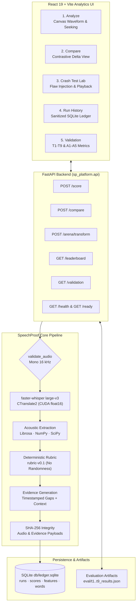

<div align="center">

# 🎙️ SpeechProof

### Evidence-backed speech scoring, plus a Crash Test Lab that asks whether the scorer deserves trust.

[](https://www.python.org/)
[](https://fastapi.tiangolo.com/)
[](https://react.dev/)
[](https://github.com/SYSTRAN/faster-whisper)
[](https://github.com/OpenNMT/CTranslate2)
[](https://www.sqlite.org/)
[](https://docs.pytest.org/)
[](LICENSE)


**[Overview](#-overview) · [Architecture](#-architecture) · [Quick start](#-quick-start) · [API](#-api-reference) · [Crash Test Lab](#-crash-test-lab) · [Validation Matrix](#-validation-matrix) · [AI Attribution](#-ai-assisted-development)**

</div>

---

> ⚠️ **Scientific Honesty Disclosure:** The scoring pipeline, evidence hashing, Crash Test Lab flaw injectors, and web application are fully implemented and verified with software test suites. The empirical evaluations (T1–T9 and A1–A5) are reported honestly from actual artifact data based on the single authorized pilot recording (`aryan_test.wav`). Missing experiments are strictly reported as **PILOT**, **INCONCLUSIVE**, or **NOT_RUN** without manufacturing artificial passing ratings.

---

## 📌 Overview

SpeechProof is a speech-scoring research platform paired with an adversarial **Crash Test Lab** and an interactive React analytics dashboard.

- **The Scorer:** Analyzes mono 16 kHz WAV audio, generates offline word-level ASR transcripts with `faster-whisper` (`large-v3` on CUDA `float16`), calculates deterministic acoustic feature rubrics (pace, pausing, pitch variety, and vocal energy), and produces timestamped evidence intervals anchored to the audio waveform.
- **Evidence Integrity:** Generates cryptographic SHA-256 hashes of both the raw audio bytes and the canonicalized evidence JSON, storing verified records in an SQLite audit ledger (`db/ledger.sqlite`).
- **Crash Test Lab:** Injects controlled audio perturbations (pause insertion, phase-vocoder pace time-stretching, and decibel gain scaling) to audit how the scoring rubric responds under stress.
- **Modern React Interface:** Provides a 5-tab research workspace: **Analyze** (with HTML5 Canvas amplitude envelope waveform and interactive timestamp seeking), **Compare** (contrastive delivery analysis), **Crash Test Lab** (real-time flaw injection and side-by-side playback), **Run History** (sanitized audit log), and **Validation Matrix** (live artifact-driven evaluation results).

---

## ✨ System Architecture



---

## 🧰 Technology Stack

| Layer | Component | Notes |
|---|---|---|
| **Frontend** | React 19, TypeScript, Vite | Dark navy/slate research theme, HTML5 Canvas waveform, zero bloat |
| **Backend API** | FastAPI, Uvicorn, Starlette | RESTful routes, validated safety bounds, base64 audio return |
| **Speech Recognition** | `faster-whisper`, CTranslate2 | Canonical `large-v3`, CUDA `float16`, local offline cache (`./model_cache`) |
| **Audio Processing** | Librosa, SoundFile, NumPy, SciPy | 16 kHz mono validation, phase vocoder time-stretching, dB gain scaling |
| **Integrity & Storage** | SQLite (`db/ledger.sqlite`), SHA-256 | Local offline persistence; optional Supabase lazy config |
| **Testing** | Pytest, FastAPI TestClient | 100+ automated unit, regression, and route tests |

---

## 🚀 Quick Start

### 1. Environment Setup

```bash
git clone https://github.com/aryankalpeshchavan-glitch/SpeechProof.git
cd SpeechProof

# Activate conda or virtual environment with Python 3.11+
conda activate speechproof
```

### 2. Verify GPU and Model Readiness

SpeechProof enforces a strict **no-silent-CPU-fallback** policy when CUDA is configured. The model is stored locally in `./model_cache`:

```bash
python gpu_preflight.py
```

Expected output:
```text
ctranslate2 cuda supported types: {'float16', ...}
WhisperModel initialized successfully on GPU.
```

### 3. Build Frontend & Launch Server

```bash
# Optional: re-build frontend if editing React code
cd web
npm install
npm run build
cd ..

# Launch FastAPI local server
python -m uvicorn sp_platform.api:app --host 127.0.0.1 --port 8000 --reload
```

Open your browser at **`http://localhost:8000`** to access the SpeechProof web application. API documentation is available at **`http://localhost:8000/docs`**.

---

## 🧪 Running Tests

```bash
# Run complete test suite (102 tests)
pytest -q

# Run compilation check across all modules
python -m compileall speechproof sp_platform db contracts tests eval inject

# Check git whitespace and diff hygiene
git diff --check
```

---

## 📡 API Reference

| Method | Path | Status | Description |
|---|---|---|---|
| `GET` | `/health` | ✅ Implemented | Returns web application health without instantiating heavy models |
| `GET` | `/ready` | ✅ Implemented | Checks CUDA runtime compatibility and local model cache readiness |
| `POST` | `/score` | ✅ Implemented | Scores mono 16 kHz WAV audio; returns scores, duration, regions, and SHA-256 |
| `POST` | `/compare` | ✅ Implemented | Contrastive side-by-side comparison of candidate vs reference delivery |
| `POST` | `/arena/transform` | ✅ Implemented | Controlled flaw injection (pause, pace, volume), scoring both and returning deltas & audio |
| `GET` | `/leaderboard` | ✅ Implemented | Returns sanitized run history from SQLite (hiding local file system paths) |
| `GET` | `/validation` | ✅ Implemented | Dynamically loads empirical results from `eval/t*_results.json` artifacts |

---

## 🧨 Crash Test Lab

The Crash Test Lab validates whether the rubric responds predictably to controlled audio transformations:

1. **Pause Insertion (`inject.pause.inject_pause`):**
   - **Parameter:** `pause_sec` in `[0.5, 5.0]` seconds.
   - **Target Dimension:** `pausing`.
   - **Mechanism:** Inserts exact zero-signal silence interval at audio midpoint.
2. **Pace Modification (`inject.pace.inject_pace`):**
   - **Parameter:** `rate` in `[0.5, 1.5]` rate multiplier.
   - **Target Dimension:** `pace`.
   - **Mechanism:** Time-stretches audio using phase vocoder while preserving pitch.
3. **Volume Modification (`inject.volume.inject_volume`):**
   - **Parameter:** `gain_db` in `[-12.0, +12.0]` dB.
   - **Target Dimension:** `energy`.
   - **Mechanism:** Linear scaling with amplitude clipping detection.

---

## 📊 Validation Matrix (T1–T9 & A1–A5)

| Test ID | Evaluation Property | Current Status | Empirical Finding / Reason |
|---|---|---|---|
| **T1** | Deterministic Reproducibility | **MET** | 100% bit-identical scores, words, and evidence hashes across 5 repeated CUDA runs. |
| **T2** | Dose-Response Monotonicity | **PILOT** | Pace responds monotonically; volume is invariant unless signal clipping occurs. |
| **T3** | Cross-Talk Isolation | **PILOT** | Evaluated on single recording pilot; target dimensions respond to injected flaw. |
| **T4** | Temporal Localization | **PILOT** | F1 = 0.40 under IoU $\ge$ 0.5 (N=1 single pause injection pilot). |
| **T5** | Nuisance Invariance (TOST) | **INCONCLUSIVE** | Equivalence margin undefined due to absence of repeated takes across conditions. |
| **T6** | Human Agreement (ICC) | **NOT_RUN** | Genuine ICC(2,k) implemented; no human subjective rating dataset available. |
| **T7** | Between/Within Variance | **NOT_RUN** | Requires multi-speaker cohort (only single authorized speaker `aryan_test.wav` available). |
| **T8** | Minimum Detectable Change (MDC95) | **INCONCLUSIVE** | Test-retest variance pairs not collected for cohort. |
| **T9** | Adversarial Gaming Resistance | **INCONCLUSIVE** | Dependent on empirical T8 MDC95 threshold. |
| **A1–A5** | Architectural Ablations | **INCONCLUSIVE** | Baseline comparison requires multi-speaker evaluation benchmark. |

---

## 🤖 AI-Assisted Development

In compliance with hackathon submission guidelines, the following AI coding assistants and models were utilized during the development of SpeechProof:

- **Google Gemini 3.8 Flash (via Google Antigravity Agentic IDE):** Used for pair programming, refactoring API endpoints, implementing the genuine ICC(2,k) formula in Python, creating the React 19 Canvas waveform component, and writing comprehensive Pytest regression suites.
- **faster-whisper (CTranslate2 large-v3):** Used as the core local offline speech recognition engine for generating word-level timestamped transcripts.

All architectural rubric logic, research protocols, and statistical evaluations were reviewed, tested, and empirically grounded.

---

## 🔒 Privacy, Consent, and Responsible Use

- **Local Processing:** All speech recognition and acoustic feature calculations execute strictly on your local machine. No audio is transmitted to external cloud APIs by default.
- **Authorized Audio Only:** Only process audio with explicit speaker consent. The included pilot audio (`data/real/aryan_test.wav`) is authorized strictly for research evaluation.
- **No Consequential Decision Making:** SpeechProof is a research prototype designed to audit scoring algorithms; it must not be used for high-stakes hiring, educational admissions, or clinical diagnoses.

---

## 📄 License

Released under the [MIT License](LICENSE). Copyright (c) 2026 Aryan Chavan.
